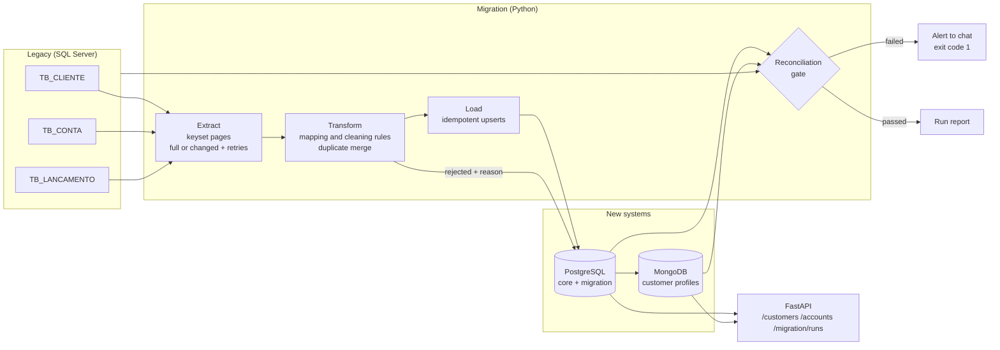

# Legacy Banking Data Migration

[](https://github.com/vitorchavernue/legacy-banking-data-migration/actions/workflows/ci.yml)

Migration of a **legacy core banking database (SQL Server)** to the systems behind a new web and
mobile app: **PostgreSQL** as the system of record and **MongoDB** for the customer profile the
apps read, plus a **REST API** on top.

The focus is what makes a financial migration safe:

- **Data mapping and cleaning rules** for real legacy problems (duplicate registrations, CPFs that lost
  their leading zeros, broken accents, codes instead of descriptions, orphan records) — see the [mapping](docs/mapping.md)
- **Full and incremental loads** (watermark + retry of rejected records), idempotent upserts, keyset pagination
- **Reconciliation as a release gate**: nothing lost, nothing invented, every transaction compared field by
  field, money totals and app balances checked — a failure stops the pipeline and sends an alert
- **Rejected records with reasons**, retried on every run until the business fixes them at the source
- **FastAPI** service (API key, masked CPF, money as text, cursor pagination)
- **CI on real databases**: SQL Server, PostgreSQL and MongoDB containers on every push

> All data is synthetic: generated names and valid-format CPFs, with defects planted on purpose.

---

## Results (full scale: 5,100 legacy customers, 46,410 transactions)

| Run | Legacy rows read | Migrated | Rejected (with reason) | Gate |
|---|---:|---:|---:|---|
| Full load | 59,175 | 58,483 | 692 | ✅ passed |
| Incremental (after a day of legacy activity) | 771 | 354 | 417 | ✅ passed |

- **100 duplicate registrations** merged into existing customers (same CPF typed in different ways).
- **45,803 transactions compared field by field** with the legacy system: 0 differences.
- **R$ 1.2 million** held in rejected transactions, reported for business review instead of silently dropped.
- The incremental run reads **771 rows instead of 59,000**: changed rows plus earlier rejects. The 24 customers
  whose CPF was fixed at the branch are migrated, and their accounts follow automatically.

Rejected by reason (full load):

| Reason | Records |
|---|---:|
| Transaction points to an account that does not exist or was not migrated | 415 |
| Amount zero or negative | 142 |
| Account points to a customer that does not exist or was not migrated | 61 |
| Transaction dated in the future | 50 |
| CPF with invalid check digits | 24 |

Each run writes a report like this one ([example in the CI summary](https://github.com/vitorchavernue/legacy-banking-data-migration/actions)):

| Check | Severity | Result | Legacy | New systems |
|---|---|---|---|---|
| Every legacy transaction is migrated or rejected | critical | ✅ | 46,410 legacy | 45,803 migrated + 607 rejected |
| Accounts belong to the right customer | critical | ✅ | | 0 with a different owner |
| Transactions match the legacy system field by field | critical | ✅ | 45,803 compared | 0 different |
| Net amount of migrated transactions matches | critical | ✅ | 11,231,862.76 | 11,231,862.76 |
| Every customer has an app profile (MongoDB) | critical | ✅ | 4,976 customers | 4,976 profiles |
| App balances match PostgreSQL | critical | ✅ | | 0 different |
| Money in rejected transactions (needs business review) | info | ⚠️ | 607 transactions | 1,218,343.95 |

---

## Architecture



| Step | What happens | Why it matters |
|---|---|---|
| **Extract** | Pages by primary key (`WHERE id > last ORDER BY id`); full = every row, incremental = rows changed since the watermark (5-min overlap) + rows rejected before | Light on the legacy system; nothing missed when rows commit late |
| **Transform** | Pure functions per field ([`rules.py`](src/migration/rules.py)); deterministic UUIDs; same CPF → one customer, newest registration wins | Every rule is unit tested; any run can be repeated and compared |
| **Load** | `INSERT … ON CONFLICT DO UPDATE` guarded by the legacy "changed at" | Re-running never duplicates and never overwrites newer data with older |
| **Profiles** | One MongoDB document per customer with accounts and balances (`Decimal128`) | The app's main screen is a single read |
| **Reconcile** | 7 critical + 3 info checks ([ADR 0003](docs/adr/0003-reconciliation-as-a-release-gate.md)) | "The job finished" is not proof; matching numbers are |

Design decisions are recorded as ADRs: [watermark sync vs CDC](docs/adr/0001-incremental-sync-by-watermark.md) ·
[MongoDB read model](docs/adr/0002-mongodb-customer-profile-read-model.md) ·
[reconciliation gate](docs/adr/0003-reconciliation-as-a-release-gate.md). The [runbook](docs/runbook.md) covers
cut-over, rollback and monitoring.

---

## API

| Endpoint | Returns |
|---|---|
| `GET /health` | Both databases reachable (no key, for monitoring) |
| `GET /customers/{cpf}` | Customer profile from MongoDB: masked CPF, accounts, balances (money as text) |
| `GET /accounts/{id}/transactions?limit=50&cursor=…` | Statement from PostgreSQL, most recent first, cursor pagination |
| `GET /migration/runs` · `GET /migration/runs/{id}` | Run history with every reconciliation check |

All endpoints except `/health` need the `X-API-Key` header (compared in constant time). OpenAPI docs at `/docs`.

---

## Tests and CI

- **Unit tests** — every cleaning rule and mapping case (CPF check digits and lost zeros, name case, encoding
  repair, date formats, signed amounts, duplicate merge, orphan rejection).
- **Integration tests on real databases** — the full scenario in order: full load → repeated full load changes
  nothing → legacy activity → incremental run picks it up → **someone edits a value directly in PostgreSQL →
  the gate fails and the alert is sent → a full run repairs it**; plus the API (auth, CPF validation, pagination
  without gaps or repeats).
- **GitHub Actions** starts SQL Server 2022, PostgreSQL 16 and MongoDB 7 containers, runs lint, unit and
  integration tests, then the end-to-end run at full scale and publishes the report in the job summary.

---

## Run it

```bash
cp .env.example .env          # connection strings
make setup                    # Python dependencies
make up                       # SQL Server, PostgreSQL and MongoDB in Docker
make demo                     # seed legacy -> full load -> legacy changes -> incremental load -> report
make test test-integration    # unit + integration tests
make serve                    # API on http://localhost:8000/docs
```

## Project structure

```
src/migration/
├── legacy/schema.py      # legacy SQL Server tables
├── legacy/seed.py        # synthetic legacy data with planted defects + day-to-day changes
├── rules.py              # cleaning and validation rules, one function per field
├── transform.py          # legacy rows -> new model + rejected records
├── extract.py            # keyset-paginated reads (full, changed, by id)
├── load.py               # idempotent upserts, rejected records, MongoDB profiles
├── reconcile.py          # reconciliation checks and release gate
├── runner.py             # one run, end to end
├── target_schema.py      # PostgreSQL core + migration control tables
├── alerts.py · report.py # chat alert, Markdown/JSON report
└── api/app.py            # FastAPI service
tests/unit · tests/integration
docs/mapping.md · docs/runbook.md · docs/adr/
```

## Stack

**Python** · **SQL** · **SQL Server** · **PostgreSQL** · **MongoDB** · **SQLAlchemy** · **FastAPI** · **Pydantic** ·
**pytest** · **Docker** · **GitHub Actions**
